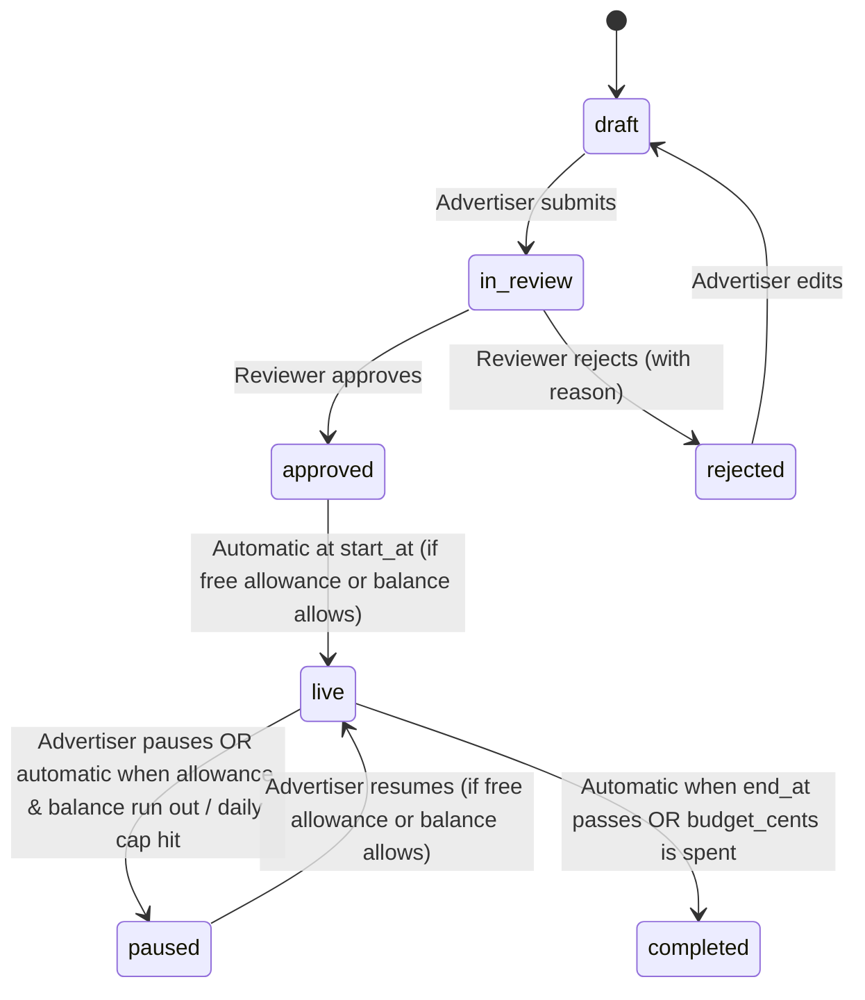

# Advertising Pipelines & State Machines

*Source: Sections 8.8–8.11 of the Rada Build Plan.*
*Phase Gate: Built in Phase 6 (`6a`–`6d`) only after the open items in [`docs/product/open-questions.md`](../product/open-questions.md) are resolved.*

---

## 1. Module Map & Encapsulation (`Section 8.11`)

Each pipeline is implemented as an isolated module with its own unit and integration test suite. External code may call a module **only through its public interface**.

| Module Path | Responsibility |
| :--- | :--- |
| `src/features/ads/watch` | Viewer-side Watch Ads tab UI (browse, category filters, tap-to-play, mute/captions/pause/skip controls, hide/report actions) |
| `src/features/ads/advertiser` | Advertiser portal UI (onboarding, campaign builder, creative uploader, daily stats, ledger view, top-up request) |
| `src/features/ads/review` | Reviewer UI (advertiser verification, ad creative checklist, report moderation) & Owner manual credit screen |
| `src/lib/ads/policy` | Campaign & ad state machines, format limits, restricted category rules |
| `src/lib/ads/media` | Signed upload URLs, MIME/malware checks, size & duration validation, poster extraction, transcoding (Phase 6d) |
| `src/lib/ads/serving` | Eligible ad selection, interest/category ordering, advertiser share rotation |
| `src/lib/ads/events` | Batched first-party event ingestion, per-owner rate limiting, 24-hour billable view deduplication |
| `src/lib/ads/billing` | 5-minute aggregation job, free allowance counter, append-only `ledger_entries`, automatic campaign pausing, nightly reconciliation |

---

## 2. The Eight Ad Pipelines (`Section 8.10`)

### Pipeline 1: Advertiser Onboarding
1. Business user signs up, verifies email, and submits business details (`name`, `website`, `contact_email`).
2. Human reviewer checks the business identity and website domain, verifying that neither the business nor the website has already received a free view allowance (**one free allowance per business and website**).
3. Reviewer approves or rejects with a written reason (`ad_reviews`).
4. On approval, `advertisers.status` becomes `'approved'`, `free_views_granted` is set from config, and the advertiser is notified by email.

### Pipeline 2: Campaign Lifecycle State Machine

- **Allowed Transitions:**
  - `draft` → `in_review` (advertiser submits; requires all ads and assets valid)
  - `in_review` → `approved` | `rejected` (human reviewer decision)
  - `rejected` → `draft` (advertiser edits campaign/ad)
  - `approved` → `live` (automatic at `start_at` if free allowance > 0 or prepaid balance covers at least 1 day of spend)
  - `live` → `paused` (advertiser action, or automatic when free allowance and prepaid balance run out)
  - `paused` → `live` (advertiser resumes, only if free allowance > 0 or prepaid balance allows)
  - `live` → `completed` (automatic when `end_at` passes or `budget_cents` is fully spent)
- **Refusal Rule:** Every transition not listed above is strictly refused with an error and covered by unit tests. Editing an already-approved ad transitions the ad back to `in_review`.

### Pipeline 3: Human Ad Review
1. An ad enters `in_review` when its campaign is submitted or when an approved ad is edited.
2. A reviewer works through the mandatory checklist in [`docs/ad-policy.md`](../ad-policy.md):
   - Advertiser identity is clear and matches the verified business.
   - Claims are accurate and not misleading.
   - Does not fall into any restricted category.
   - Required accessibility assets are present (`alt_text` on every Story image; captions file and poster on every Video).
   - Destination CTA link resolves and works cleanly.
   - Contains zero tracking scripts, pixels, or third-party code.
   - Creative is informative or entertaining (`D17`).
3. Reviewer approves or rejects with a mandatory reason stored in `ad_reviews`. Target turnaround: **2 business days**.

### Pipeline 4: Media Upload & Validation (`src/lib/ads/media`)
1. Client requests a signed upload URL (`POST /api/advertiser/assets`).
2. Uploaded file undergoes MIME-type verification and malware check.
3. Enforces exact byte size, dimension, slide count (1–5 images for Story), and duration (≤ 60 seconds for Video) limits defined in [`docs/ad-policy.md`](../ad-policy.md).
4. Extracts or verifies poster image and validates captions file (Video in Phase 6d).
5. Stores validated asset metadata in `ad_assets`. An ad cannot be submitted to `in_review` until every required asset has passed all checks.

### Pipeline 5: Ad Serving (`src/lib/ads/serving`)
When a viewer opens the Watch Ads tab (`GET /api/watch`), the server selects eligible ads that satisfy **all** of the following:
1. Watch Ads global switch is **on** (`D23`).
2. `campaigns.status = 'live'` and `ads.status = 'approved'`.
3. Current timestamp is within `[campaigns.start_at, campaigns.end_at]`.
4. Advertiser has remaining free allowance (`free_views_used < free_views_granted`) **or** positive prepaid ledger balance, and the campaign's `budget_cents` and today's `daily_cap_cents` are not exhausted.
5. Matches the category/subcategory chips chosen by the viewer in Watch Ads and any optional `regions` target (`D22`).
6. Neither the `ad_id` nor the `advertiser_id` is in the viewer's `viewer_ad_prefs` (`hidden_ad_ids`, `hidden_advertiser_ids`).

**Ordering & Rotation:**
- Ordered by viewer category filter / Popular (7-day qualified views) or Newest (`published_at`), with fair rotation so no single advertiser occupies more than a configurable maximum share of a single page.
- Each `ad_id` appears at most once per response list.

### Pipeline 6: Events & Billing (`src/lib/ads/events` & `src/lib/ads/billing`)
1. **Batched Ingestion:** Client sends batched playback events to `POST /api/watch/events`.
2. **Validation & Deduplication:** Server enforces per-owner rate limits and deduplicates billable views so **at most one `qualified_view` per owner per `ad_id` per 24 hours** is recorded in `ad_events`.
3. **Qualified View Rule:** A `qualified_view` occurs at **5 seconds of active playback or 50% of total ad duration**, whichever comes first (configurable).
4. **5-Minute Aggregation & Billing Job:**
   - Runs every 5 minutes over unprocessed `ad_events`.
   - Updates `ad_stats_daily` (`impressions`, `qualified_views`, `free_qualified_views`, `completes`, `clicks`, `spend_cents`).
   - Consumes the advertiser's remaining free allowance first (`advertisers.free_views_used` increments, `free_qualified_views` increments, `spend_cents = 0`).
   - For qualified views beyond the free allowance, calculates spend in integer cents using the campaign's active `rate_cards.price_per_qualified_view_cents` and inserts an append-only `spend` row into `ledger_entries` with a deterministic, unique `ref`.
   - Automatically transitions any campaign to `paused` (or `completed`) if its `budget_cents` or `daily_cap_cents` is reached, or if both free allowance and prepaid balance reach zero, and emails the advertiser.
   - **Idempotent & Reconcilable:** Re-running the job over the same time window or event batch produces zero duplicate ledger entries or double-counted views.

### Pipeline 7: Reporting & Nightly Reconciliation
- `ad_stats_daily` powers the Advertiser stats dashboard and `GET /api/advertiser/stats.csv`.
- Category breakdowns are suppressed whenever a segment has fewer than the minimum audience threshold (**default: 20 qualified views**).
- A **nightly reconciliation job** verifies that `SUM(ad_stats_daily.spend_cents)` equals `-SUM(ledger_entries.amount_cents WHERE type = 'spend')` and `SUM(ad_stats_daily.free_qualified_views)` equals `advertisers.free_views_used`, flagging any discrepancy in `audit_log` and operator alerts.

### Pipeline 8: Viewer Feedback & Auto-Pause on Reports
- **Not interested** (`POST /api/watch/:adId/hide`) and **Hide this advertiser** (`POST /api/watch/advertisers/:id/hide`) update `viewer_ad_prefs` immediately.
- **Report** (`POST /api/watch/:adId/report`) creates an `ad_reports` entry in the reviewer queue. If an ad accumulates reports meeting the configurable threshold, the ad is **automatically paused** (`ads.status = 'paused'`) until a human reviewer inspects it.
